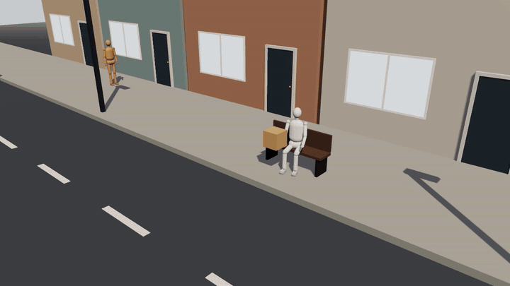
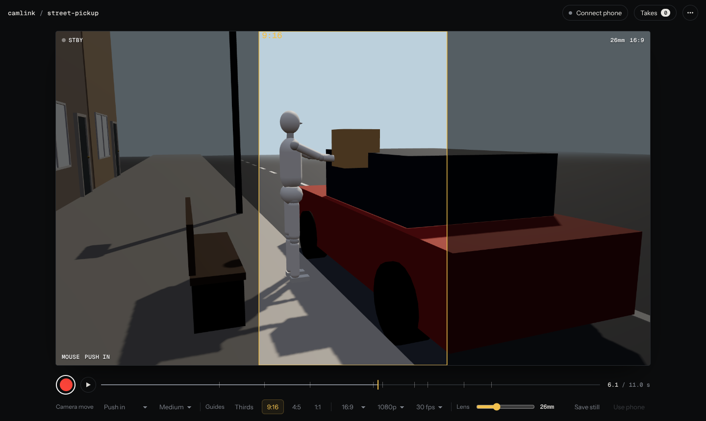
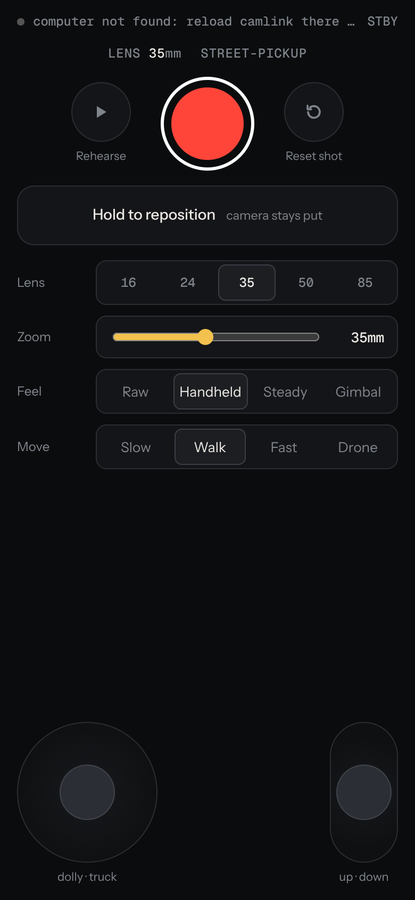
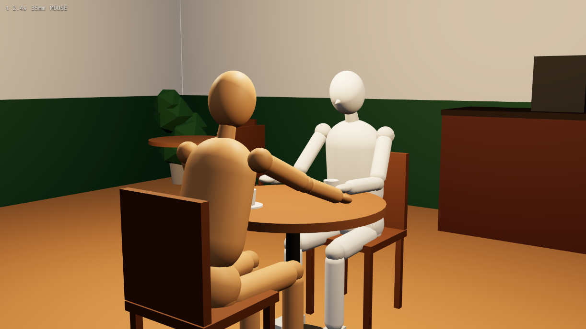

# camlink

**Your phone is the camera.** camlink turns any phone into a handheld virtual camera for 3D blocking scenes. You shoot the move by hand, and camlink gives you a frame-exact MP4 to use as the motion and blocking reference for Seedance, Luma, Runway or any video-to-video model.

**Open it:** https://sirmobyi.github.io/camlink/



## How it works

| Computer | Phone |
|---|---|
|  |  |
| Shows the scene, scrubs the action, records the take, renders the clean MP4 | Gyro for tilt and pan, sticks for dolly, truck and up/down, lens presets and a zoom slider |

1. Open camlink on your computer: Chrome, Safari or the Claude app's browser pane.
2. Scan the QR code with your phone camera, tap **Start**, allow motion access. Phone and computer link directly; no app, no install, any network.
3. Tap **Rehearse** (or press Space) to watch the action. Frame the shot with the mouse; the phone takes over from that framing.
4. Tap the red button, perform the move, tap it again. Recording stops by itself when the action ends, and a clean 24fps MP4 of the take lands in your Downloads, re-rendered frame by frame from the camera path so no frames are dropped.

The action restarts at 0 s on every take, so takes are repeatable.

## Controls

**Phone**
- **Hold to reposition**: the shot freezes while you hold it, so you can re-grip or turn your body; let go and it continues from there.
- **Reset shot**: jump back to the framing you started from.
- **Lens and zoom**: presets from 16 to 85 mm, plus a zoom slider (12 to 135 mm) that eases like a real zoom.
- **Feel**: Raw, Handheld, Steady or Gimbal smoothing. **Move**: stick speed from Slow to Drone.

**Computer**
- **Timeline**: drag to any second; ticks mark the beats of the action. Space plays, arrow keys step.
- **Camera move**: push in, pull out, truck, crane or orbit, subtle to big. With the phone linked the move carries the camera like a dolly while you aim.
- **Guides**: rule of thirds, and 9:16, 4:5 or 1:1 crop frames for vertical and square cuts.
- **Save still**: the current frame as PNG. Each take also has **First frame** for styling a keyframe image.
- **Lens slider** for mouse framing. Press `?` for all shortcuts.

## Scenes

A scene is a small JavaScript file built with the kit in [`kit.js`](kit.js): rooms, streets, furniture, cars, doors, props and jointed mannequins with poses. `kit.timeline()` adds character and object motion: walk paths, pose beats, keyframed moves, door swings, props passed from hand to hand, characters turning to look at each other.

**Scenes live in the link.** The scene code is compressed into the URL (`#scene=...`), so every scene is a shareable link that opens exactly the same blocking for anyone.

Demo scenes:
- [`?scene=cafe-argument`](https://sirmobyi.github.io/camlink/?scene=cafe-argument): two people at a café table, one leans in and points.
- [`?scene=street-pickup`](https://sirmobyi.github.io/camlink/?scene=street-pickup): a car pulls in, a woman carries a parcel over and loads it, a passer-by crosses behind.



You can also drag a scene file (`.js`) or your own model (`.glb`, for example a Blender glTF export) onto the page.

## Use it with Claude

The `phone-virtual-camera` skill teaches Claude to write scenes, load them, check the key beats and hand you a link. Then in any chat:

> use camlink to block this scene: a courier walks into a café, hands a parcel to the barista and walks out

**Install the skill:** download [`skill/phone-virtual-camera.skill`](skill/phone-virtual-camera.skill), then in Claude go to **Customize → Skills** and upload it. The readable version is [`skill/phone-virtual-camera/SKILL.md`](skill/phone-virtual-camera/SKILL.md).

In the Claude desktop app, Claude opens camlink in its own browser pane and loads the scene there. Elsewhere it gives you the scene link to open.

## Using the take for generation

Use `<take>_clean.mp4` as the reference video. Give each character a distinct mannequin colour and map those colours to your reference images in the prompt:

```
@Video 1 is a grey-box 3D blocking pass. Match its camera movement, lens, framing, character
blocking and timing exactly. Change only the look: photoreal live action.
Cast: the white mannequin is @Image 1. The wooden mannequin is @Image 2.
Location: @Image 3. Action: [beats with seconds]. Background motion: [everything else that moves].
```

## Exports

- **Clean MP4**: frame-exact 24fps render of the take (H.264, encoded in the browser).
- **First frame / still**: PNG of the take's opening frame or of any moment you scrub to.
- **Realtime**: the clip as it was recorded live.
- **Camera path**: JSON with position, rotation and focal length per frame (metres, +Y up, 36 mm sensor).
- **Scene .glb**: the blocking set and cast for Blender or other 3D tools.

**Blender:** [`blender/camlink_blender.py`](blender/camlink_blender.py) provides `camlink_import_scene(glb)` and `camlink_import_take(json)`, which key a camera that lines up exactly with the imported scene.

## Troubleshooting

- **Red message instead of a scene:** read it. A WebGL message means the browser has 3D graphics off. In Brave, lower Shields for the site or turn on graphics acceleration. Chrome, Safari and the Claude browser work out of the box.
- **Phone stuck on "connecting…":** reload the computer page and rescan. If it still won't link, put both devices on the same Wi-Fi or the phone's hotspot; some office networks block direct connections.
- **"no motion sensor events" on iPhone:** Settings → Safari → Motion & Orientation Access, then reload.
- **The camera's pan drifts or you run out of room to turn:** hold **Hold to reposition**, turn, let go.

## Repository

```
index.html      viewer: scene, recording, clean MP4 render, phone link
phone.html      phone controller
kit.js          blocking kit: set, props, mannequins, poses, timeline
scenes/         demo scenes (?scene=<name>)
beta/           next version under test, live at /camlink/beta/
blender/        Blender import script
skill/          the Claude skill (.skill package and SKILL.md)
docs/           README images
vendor/         three.js r160, PeerJS 1.5.4, mp4-muxer 5.1.3, qrcode-generator 1.4.4 (all MIT)
```

Static site on GitHub Pages; no build step. The phone link uses WebRTC through the public PeerJS signalling server.
